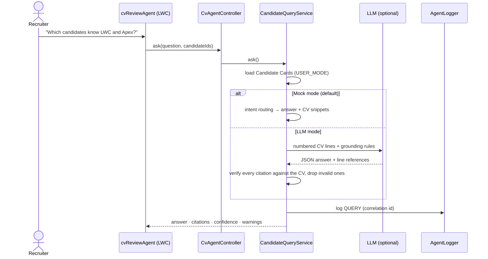

# CV Review Agent on Salesforce

A Salesforce-native agent that helps recruiters **ingest CVs, ask grounded questions about candidates, compare them against a role, and bookmark evaluations**, with every value traceable to the CV it came from.

> **Guiding principle:** the agent should never claim more than the CV supports. Every field is labelled **FOUND**, **INFERRED**, **MISSING** or **CONFLICT**. Every answer cites the CV. Every score is a sum of explained parts.

---

## 1. Quick start (5 minutes)

```bash
sf org login web --alias cvagent --set-default
sf project deploy start --target-org cvagent
sf org assign permset --name CV_Review_Agent_User --target-org cvagent
sf apex run test --target-org cvagent --test-level RunLocalTests --code-coverage --wait 30
```

1. Open the App Launcher, then **CV Review Agent**.
2. Click **Load 5 sample CVs**. Three PDFs and two DOCX files, each built to exercise a specific edge case (see §8).
3. **Ask the agent** tab: try the suggested questions, including one the CVs can't answer ("Who speaks Mandarin?").
4. **Compare & recommend** tab: click *Evaluate candidates* with the example role, open *Why this score?*, then **Bookmark** a candidate with notes.
5. Inspect the **Candidate Bookmarks** and **Agent Logs** tabs.

No API key is needed. The agent runs in deterministic **Mock** mode by default. See §6 to switch on Claude.

---

## 2. Architecture

```mermaid
flowchart LR
    subgraph UI["🖥️ Recruiter UI (LWC)"]
        direction TB
        T1["1 · Candidates<br/>upload & cards"]
        T2["2 · Ask the agent<br/>Q&A + citations"]
        T3["3 · Compare<br/>score & bookmark"]
    end

    AF["🤖 Agentforce / Flow<br/>invocable actions"]
    CTRL["CvAgentController<br/><i>thin facade</i>"]

    subgraph SVC["⚙️ Services · with sharing · USER_MODE"]
        direction TB
        ING["CvIngestionService"]
        QRY["CandidateQueryService"]
        SCR["CandidateScoringService"]
        BMK["CandidateBookmarkService"]
    end

    subgraph DOM["🧩 Extraction & grounding"]
        direction TB
        EXT["CvTextExtractor<br/>PDF · DOCX · TXT"]
        PARSE["HeuristicCvParser<br/>rules"]
        VAL["CardValidator<br/>grounding check"]
    end

    subgraph AI["🧠 Optional LLM"]
        direction TB
        PROV["LlmProvider<br/>interface"]
        IMPL["AnthropicLlmProvider<br/>Named Credential"]
    end

    subgraph DATA["🗄️ Salesforce data"]
        direction TB
        CAND[("Candidate__c")]
        BM[("Candidate_Bookmark__c")]
        LOG[("Agent_Log__c")]
    end

    UI --> CTRL --> SVC
    AF --> SVC
    SVC --> DOM
    DOM -. "LLM mode" .-> AI
    SVC --> DATA
    PROV --> IMPL

    classDef ui fill:#e3f3ff,stroke:#0176d3,color:#014486
    classDef svc fill:#ebf7e6,stroke:#2e844a,color:#194e31
    classDef ai fill:#fef7ec,stroke:#dd7a01,color:#8c4b02
    classDef data fill:#f3f3f3,stroke:#706e6b,color:#181818
    class T1,T2,T3,CTRL,AF ui
    class ING,QRY,SCR,BMK,EXT,PARSE,VAL svc
    class PROV,IMPL ai
    class CAND,BM,LOG data
```



| Component | Role |
|---|---|
| **Services** | Ingestion, Q&A, scoring (rules only — the LLM never scores), bookmarks (immutable snapshots) |
| **Extraction & grounding** | Text extraction, rule-based parsing, and verification of any LLM output against the CV text |
| **Optional LLM** | Behind an interface — swap providers or stub it in tests; off by default (no data leaves Salesforce) |
| **Audit** | Every action is logged via a publish-immediately platform event → `Agent_Log__c`, with a correlation id shared with bookmarks |

**Request flow (ask a question):**



**Layers**

| Layer | Responsibility |
|---|---|
| `cvReviewAgent`, `candidateCard` (LWC) | UX only: no business rules. Shows provenance (✓ found, ? inferred, ✗ missing, ⚠ conflict), citations, confidence, score breakdown. |
| `CvAgentController` | Input validation, delegation, converts exceptions into user-friendly messages with a **reference id** (the correlation id in Agent Logs). |
| Services | `CvIngestionService`, `CandidateQueryService`, `CandidateScoringService`, `CandidateBookmarkService`: all `with sharing`, SOQL `WITH USER_MODE`. |
| Domain | `CandidateCard` (schema), `HeuristicCvParser`, `SkillCatalog`, `RoleProfile`, `CardValidator`. |
| AI boundary | `LlmProvider` interface. `AnthropicLlmProvider` is one implementation and can be swapped for Einstein/Models API. Business logic never depends on a vendor. |
| Observability | `AgentLogger` → platform event → `Agent_Log__c`. |

---

## 3. Data model

### `Candidate__c`: the Candidate Card
Key values are **promoted to fields** (filterable, reportable). The **full card with provenance** is stored as JSON in `Card_JSON__c`.

| Field | Purpose |
|---|---|
| Name, Email, Phone, Location, Headline | Promoted from the card |
| `Total_Years_Experience__c` | **Computed from the employment timeline** (overlaps merged) |
| `Claimed_Years_Experience__c` | What the candidate *says* (kept separately so conflicts are visible) |
| `Skills__c` | Normalised skills for search/filter |
| `Card_JSON__c` | Full Candidate Card (see below) |
| `Raw_Text__c` | Extracted CV text, the **primary source of truth** for grounding |
| `Extraction_Status__c` | Extracted / Needs Review / Failed |
| `Data_Completeness__c`, `Missing_Count__c`, `Conflict_Count__c`, `Inferred_Count__c` | Data-quality metrics for list views & reports |
| `Source_Document_Id__c` (unique, external id) | Re-uploading the same file **updates** instead of duplicating |

### Candidate Card schema (`CandidateCard.cls`, v1.0)
```jsonc
{
  "name":  { "value": "Omar Khalil", "status": "FOUND", "confidence": 0.9, "evidence": "Omar Khalil", "note": "..." },
  "email": { "value": "omar.khalil@example.com", "status": "CONFLICT", "note": "Also found: omar.k.dev@gmail.com" },
  "totalYearsExperience":   { "value": "8.4", "status": "CONFLICT", "note": "Computed from dated roles (overlaps merged)." },
  "claimedYearsExperience": { "value": "12",  "status": "CONFLICT", "evidence": "12+ years" },
  "skills": [ { "name": "React", "status": "FOUND", "evidence": "Skills section: \"React\"" },
              { "name": "LWC",   "status": "INFERRED", "evidence": "Built Lightning Web Components for a client's Salesforce org..." } ],
  "experience": [ { "title": "...", "company": "...", "startDate": "2022-01", "endDate": null, "isCurrent": true,
                    "months": 59, "datePrecision": "MONTH", "evidence": "<original line>", "highlights": [...] } ],
  "education": [...], "certifications": [...],
  "issues": [ { "type": "CONFLICT", "field": "yearsExperience", "severity": "HIGH",
                "message": "Summary claims \"12+ years\" but the dated roles add up to about 8.4 years.", "evidence": "12+ years" } ],
  "completeness": 100
}
```
**How the three hard cases are represented**

| Case | Representation |
|---|---|
| **Missing** | `status: MISSING`, value `null`, plus an `Issue` explaining the impact ("candidate cannot be contacted by email"). Never filled with a placeholder. |
| **Uncertain / inferred** | `status: INFERRED` with lower `confidence` and the **evidence sentence** (e.g. LWC inferred from a bullet point). Inferred skills earn half credit in scoring. |
| **Conflicting** | `status: CONFLICT` on every affected value, with a note listing the alternatives, plus a HIGH/MEDIUM `Issue`. The agent never silently picks a side. For years of experience it uses the **lower, date-based** figure and says so. |

Detected automatically: multiple emails, claimed vs computed experience, overlapping roles, unexplained gaps (≥6 months), end-before-start dates, undated roles, year-only dates (approximated, flagged), duplicate certifications with different years, missing contact data/graduation years, and duplicate applications (same email, different file).

### `Candidate_Bookmark__c`: a recruiter's saved evaluation
One record per bookmark, created after an evaluation (`BM-00001`):

* **Candidate overview** (snapshot of key extracted details), **score**, **fit tier**, **rank / number compared**, **reasoning** (strengths & concerns), **score breakdown JSON** (explainability), **interview focus**, **role criteria JSON**, **evaluated at**, **scoring version**, **correlation id**.
* **Recruiter notes** entered at creation time. `Status__c` (New → Shortlisted → Interviewing → Rejected) is editable, and both have field history tracking.
* **Snapshot, not reference.** If the CV is re-processed or scoring weights change, an old bookmark still shows exactly what the recruiter saw. `Scoring_Version__c` tells you which model produced the score.
* **Auditability.** Snapshot fields are **read-only via FLS**, so only notes and status can be edited. `Candidate__c` lookup uses `Restrict` delete, so a candidate with bookmarks can't be deleted. `Correlation_Id__c` links the bookmark to the `EVALUATE` log entry that produced it.
* **Retrieval / filtering:** role, tier, score, status, date and candidate are all real fields, ready for list views and reports.

### `Agent_Log__c` (+ `Agent_Log_Event__e`)
Action (INGEST / QUERY / EVALUATE / BOOKMARK / errors), status, provider, duration, input, output (incl. the full ranking and recommendation), error + stack trace, user, correlation id.

### `CV_Agent_Setting__mdt` (record `Default`)
AI provider (`Mock` | `Anthropic`), Named Credential, model, scoring weights, tier thresholds, scoring version. Configuration is deployable and does not need code changes.

---

## 4. How each requirement is met

### 4.1 CV ingestion & structuring
* Multi-file upload (`lightning-file-upload`, up to 10 per batch) → `CvIngestionService.ingest`.
* **Per-file isolation:** one broken CV never fails the batch, and each file reports Extracted / Needs Review / Failed with a reason.
* **Text extraction natively in Apex** (`CvTextExtractor`): DOCX via `Compression.ZipReader`, PDF via a content-stream reader, TXT as-is. Legacy `.doc` is rejected with an actionable message.
* **Two extraction strategies behind one schema:**
  * **Rules** (`HeuristicCvParser`): deterministic, testable, no data leaves Salesforce.
  * **LLM** (`LlmCvExtractor`): Claude extracts the same JSON schema with per-field status and verbatim evidence. PDFs are sent as **native document blocks**, so compressed/complex PDFs work too. Output is then **grounding-checked** (`CardValidator`): any "FOUND" value not present in the CV is downgraded to INFERRED and flagged. Timeline maths (years, gaps, overlaps) **always comes from the rules engine**, not the model.
  * If the LLM fails, ingestion **falls back to rules** and says so.
* Callouts happen **before** any DML (Apex callout-after-DML constraint). Logs are buffered and flushed at the end.

### 4.2 Natural-language querying
`CandidateQueryService.ask(question, candidateIds?)`, used for single-candidate questions (names in the question narrow the scope) or across all/selected candidates.

* **Rules mode:** intent routing for contact, location, education, certifications, years, skills (AND/OR), risks, overview, then a **keyword-retrieval fallback** that returns *quoted excerpts* at LOW confidence instead of a synthesised claim.
* **LLM mode:** CVs are given to the model as **numbered lines** (`[C2:L14]`). The model must return JSON with line references and quotes. **Every citation is verified** against the actual line, invalid ones are removed, and an answer with no surviving citation is downgraded to LOW.
* Every answer has **citations** (candidate + verbatim snippet), a **confidence** (HIGH / MEDIUM / LOW / **NONE = "the CVs don't say"**), warnings, and the mode used.

### 4.3 Comparison & recommendation
`CandidateScoringService` uses transparent, weighted rules:

| Criterion | Weight | Rule |
|---|---|---|
| Required skills | 45% | listed = 1.0, inferred only = 0.5, absent = 0 |
| Experience | 25% | computed years ÷ required years (capped at 1). Uses the **timeline, not the claim** |
| Nice-to-have | 15% | same credit rule |
| Data confidence | 15% | ½ × completeness + ½ × (1 − penalties: HIGH issue 0.25, MEDIUM 0.10) |

* **Knock-out rule:** missing any required skill means the candidate can't be a *Strong Match*, whatever the score.
* Tiers: Strong ≥ 75, Possible ≥ 55, else Weak (configurable).
* Ties are broken by fewer HIGH issues, then more experience.
* Output per candidate: score = **exact sum of explained criteria**, strengths, concerns, **interview focus** (generated from gaps, inferred skills and conflicts).
* **Recommendation:** up to 3 Strong matches. Otherwise *"No strong match. Best available option: X. Validate before progressing: …"*.
* **Trade-offs:** where #2 beats #1 on any criterion, near-ties (< 5 pts) and top candidates with HIGH data issues are all spelled out.

**Why the LLM doesn't score:** scores must be reproducible, comparable across candidates and explainable after the fact (audit). An LLM is good at reading CVs and phrasing answers, but it is not a stable scoring function.

### 4.4 Bookmarking & notes
After evaluation, each candidate has a **Bookmark** button. A modal shows role, score, tier and rank and takes recruiter notes, then creates one `Candidate_Bookmark__c` snapshot (see §3). A toast links to the record.

### 4.5 Robustness
Empty/oversized/corrupt files, unsupported formats, scanned or compressed PDFs (flagged *Needs Review* rather than guessed), CVs with no recognisable name (name inferred from email and flagged HIGH), undated roles, year-only dates, overlapping roles, gaps, duplicates, LLM outages, malformed LLM JSON and hallucinated values or citations are all handled.

---

## 5. Security, error handling, observability

* **Sharing & CRUD/FLS:** all services are `with sharing`, and all SOQL uses `WITH USER_MODE` / DML `AccessLevel.USER_MODE`. One deliberate exception: bookmark insert uses system mode **after an explicit object-create check**, because its snapshot fields are intentionally read-only to users (so nobody can edit a score after the fact).
* **Private OWD** for Candidate and Bookmark (CVs are PII). Agent Log is Read.
* **Permission set** `CV_Review_Agent_User`: least privilege (no delete on bookmarks/logs, read-only logs and snapshot fields).
* **Secrets:** the API key lives in a **Named / External Credential**, never in code or custom settings.
* **Data residency:** default Mock mode sends nothing outside Salesforce. LLM mode is an explicit admin decision.
* **Errors:** typed exceptions per service. The controller converts them to friendly `AuraHandledException`s. Unexpected errors show a **reference id** that matches the log entry, so users never see stack traces.
* **Observability:** `AgentLogger` buffers entries and publishes **publish-immediately platform events**, so audit entries survive transaction rollbacks, and flushing after callouts avoids callout-after-DML errors. One **correlation id** per request ties logs and bookmarks together.

---

## 6. Enabling the LLM provider (Claude)
1. Setup → **External Credentials** → New: `Anthropic`, authentication protocol *Custom*. Add a principal with an `apiKey` parameter, and a **custom header** `x-api-key = {!$Credential.Anthropic.apiKey}`.
2. Setup → **Named Credentials** → New: `Anthropic_API`, URL `https://api.anthropic.com`, External Credential `Anthropic`, *Generate Authorization Header* unchecked.
3. Grant the External Credential principal to the `CV_Review_Agent_User` permission set.
4. Edit Custom Metadata **CV Agent Setting → Default**: `Provider = Anthropic` (optionally change `Model`).

The UI header shows which provider is active. Switching back to `Mock` is instant.

### Agentforce
`AskCandidatesAction` and `EvaluateCandidatesAction` are `@InvocableMethod`s with descriptions written for agent planners. Add them as **Agent Actions** in Agentforce Builder (or use them in Flow) to expose the same grounded logic conversationally.

---

## 7. Key design decisions & trade-offs

| Decision | Why | Trade-off |
|---|---|---|
| Provenance on every value (FOUND / INFERRED / MISSING / CONFLICT + evidence) | The brief prioritises honesty about ambiguity. Recruiters need to know what to trust. | A larger, more complex card schema. |
| Rules engine as default, LLM optional behind an interface | Deterministic, testable, free, no PII leaves the org. It also acts as the **verifier** for LLM output. | Rules are brittle on unusual CV layouts. These degrade to *Needs Review*, not to wrong data. |
| Card stored as JSON + promoted fields (instead of child objects for skills/experience) | Fast to build, schema can evolve (versioned), keeps one record per CV. Promoted fields cover filtering. | Can't report on individual experience rows. Child objects would be the next step for analytics. |
| Deterministic scoring, LLM never scores | Reproducible, explainable, auditable. Weights are config. | Less nuanced than human-like judgement (e.g. "led a team" isn't scored). Covered by interview focus instead. |
| Inferred skill = half credit | Rewards evidence without treating a passing mention as proficiency. | The 0.5 constant is a judgement call, documented and configurable in one place. |
| Experience from dates, not claims | Claims are the least reliable part of a CV. | Penalises candidates who omit dates. That is surfaced as a MISSING issue rather than hidden. |
| Bookmark = immutable snapshot | Audit trail stays stable even if CV or scoring changes. | Data duplication (small). |
| Logging via platform events | Survives rollbacks, decouples logging, avoids callout-after-DML. | Asynchronous: logs appear a moment later. |
| Native Apex text extraction | No external dependency for the prototype. | Only uncompressed PDFs are read natively. Compressed/scanned PDFs need LLM mode (native PDF support) or a document-AI service. |
| Synchronous ingestion (≤10 files) | Simple UX with immediate feedback. | Not suitable for bulk loads (see §9). |

## 8. Assumptions

* CVs are in English and broadly follow common conventions (section headers, "Title | Company | Dates" lines, a skills list).
* The first line of a CV is the candidate's name (flagged otherwise).
* "Present/Current" means today. Year-only dates assume mid-year (flagged as approximate).
* A recruiter's role definition is structured (title, required/nice-to-have skills, min years), not free text, which keeps scoring reproducible.
* CVs are small (< 3 MB). Up to 25 candidates per question and 50 per comparison in this prototype.
* Certifications are self-reported (the agent says so and suggests verification).

### The sample CVs (`sample-cvs/`, also in static resource `CvAgentSampleCvs`)
| CV | Format | What it tests |
|---|---|---|
| Sara Haddad | PDF | Clean, complete CV. Should rank #1 as a Strong Match for the example role. |
| Omar Khalil | DOCX | **Conflicts:** claims 12+ years (timeline ≈ 8.4), two different emails, overlapping roles, year-only dates. LWC only *inferred*. Education year missing. |
| Lina Mansour | PDF | **Missing data:** no email or phone, current role has no start date (experience is a lower bound), no graduation year. |
| Daniel Reyes | DOCX | Same certification listed with two different years, a 19-month employment gap, REST APIs only inferred. Strong but with things to validate. |
| Priya Nair | PDF | Adjacent profile (data analyst). Salesforce exposure only inferred. Best available for the "no strong match" role. |

## 9. Known limitations & what I'd do next

1. **Document AI:** use the LLM path (or Salesforce Document AI / Intelligent Document Reader) for all PDFs, plus OCR for scanned CVs. Add `.doc` conversion.
2. **Async ingestion at scale:** a Queueable per file (or Platform Event fan-out) with a progress indicator. Bulk uploads beyond the synchronous limits.
3. **Semantic retrieval:** embeddings (Data Cloud vector search) for questions that keyword/intent routing can't handle ("who has worked in fintech?"). This would replace the keyword fallback.
4. **Child objects** for Experience/Skill/Certification for reporting ("all candidates with LWC") and SOQL-level filtering, plus an editable skill taxonomy in Custom Metadata (currently `SkillCatalog` in code).
5. **Recruiter corrections:** let recruiters resolve conflicts and mark inferred values as confirmed, with history. This would turn the issue list into a workflow.
6. **Richer scoring:** seniority/leadership signals, recency of skill use, role-specific weights per job requisition. Calibrate weights against real hiring outcomes and add bias review (scoring ignores name, location, gender and age by design today; keep it that way and test for it).
7. **Agentforce agent:** a configured agent with topics and the invocable actions, plus Prompt Builder templates for the LLM prompts (versioned, governed).
8. **Privacy/compliance:** retention policy and automated purge of CV text, consent tracking, field-level encryption (Shield) for PII.
9. **Testing:** Jest tests for the LWCs, an evaluation set of real anonymised CVs with expected cards (precision/recall per field), and a regression suite for prompt changes.

## 10. Testing approach

* **9 Apex test classes**, assert-heavy, covering behaviour as well as coverage.
  * `HeuristicCvParserTest`: one test per edge case, using the same 5 fixture CVs as the sample data, with a fixed "as of" date for stable year maths.
  * `CvTextExtractorTest`: real PDF/DOCX bytes generated in-test (`Compression.ZipWriter`), plus compressed, corrupt and unsupported files.
  * `CvIngestionServiceTest`: mixed formats with partial failure, idempotent re-upload, duplicate detection, LLM-outage fallback, file linking, audit logs.
  * `CandidateQueryServiceTest`: every intent, scoping by name, "not in the CVs" answers (confidence NONE), and LLM citation verification (hallucinated refs removed, uncited answers downgraded, outage fallback).
  * `CandidateScoringServiceTest`: ranking, knock-out rule, conflict handling, "no strong match" path, score = sum of parts.
  * `CandidateBookmarkServiceTest`: snapshot contents, correlation id, mismatched-evaluation guard.
  * `CvAgentControllerTest`: end-to-end with the **real sample PDFs/DOCX from the static resource**, plus friendly errors.
  * `AgentInfrastructureTest`: Anthropic callout (HttpCalloutMock), grounding validator, logger via platform events, settings, skill matching.
  * `AgentActionsTest`: Agentforce invocable actions.
* Tests run as a **Standard User with only the permission set**, so CRUD/FLS/sharing enforcement is exercised for real.
* The LLM is behind an interface, so tests use a stub (`TestDataFactory.StubLlm`) with no callouts.

---

### Repository layout
```
force-app/main/default/
  classes/        services, domain, AI boundary, controller, invocable actions, tests
  lwc/            cvReviewAgent (workspace), candidateCard (provenance-aware card)
  objects/        Candidate__c, Candidate_Bookmark__c, Agent_Log__c, Agent_Log_Event__e, CV_Agent_Setting__mdt
  customMetadata/ CV_Agent_Setting.Default
  triggers/       AgentLogEventTrigger
  permissionsets/ CV_Review_Agent_User
  staticresources/CvAgentSampleCvs (5 sample CVs)
  layouts/ tabs/ applications/
sample-cvs/       the 5 synthetic CVs
scripts/          generate_sample_cvs.py (reproducible test data)
```
